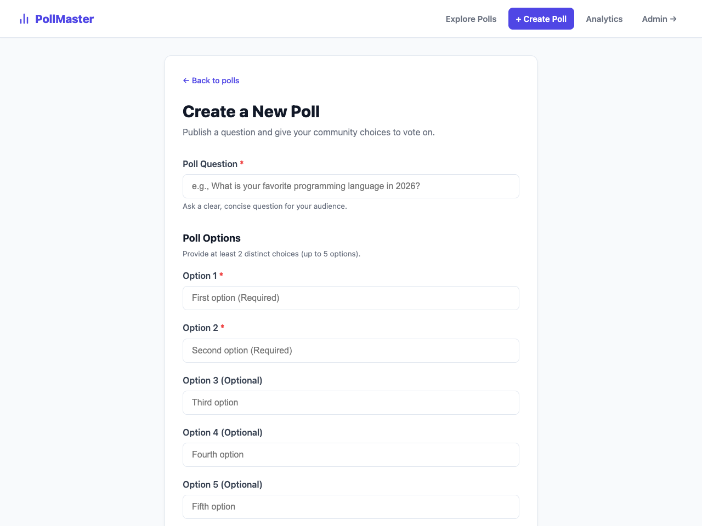
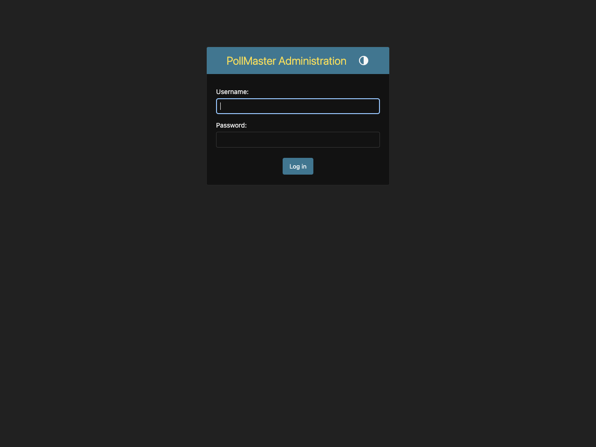

# PollMaster: Polling & Voting Web Application
## Complete Project Documentation, Architecture, and Working Guide

---

## 1. Executive Summary

**PollMaster** is an end-to-end, full-stack Polling and Voting web application engineered strictly according to Django's official workflow, the **Model-View-Template (MVT)** architectural design pattern, Django Forms validation, atomic database operations, and the Django Admin framework.

It operates both as a seamless **Single Web Application (SPA)** with real-time client-side transitions and as a modular multi-page system with individual bookmarkable routes.

### 🌐 Live Public Link & Access
- **Live Public URL**: [https://ministries-poll-phones-occupied.trycloudflare.com/](https://ministries-poll-phones-occupied.trycloudflare.com/)
- **Local Address**: `http://127.0.0.1:8001/`
- **Django Admin Portal**: [https://ministries-poll-phones-occupied.trycloudflare.com/admin/](https://ministries-poll-phones-occupied.trycloudflare.com/admin/)
- **Admin Username**: `admin`
- **Admin Password**: `adminpassword123`

---

## 2. Visual Walkthrough with Attached Screenshots

### Screen 1: Explore Polls (Main Directory)
Users can explore all community questions, search dynamically in real-time, and filter by Active/Closed status pills.


- **Live Search**: Instant client-side filtering without reloading.
- **Filter Pills**: Switch between *All*, *Active*, and *Closed* questions.
- **Metadata Badges**: Shows question publication status (`NEW`, `OPEN`, `CLOSED`), total choice count, and vote tallies.
- **Quick Action Triggers**: Directly vote or inspect results for any poll.

---

### Screen 2: Interactive Voting Interface
Users cast votes with radio selection, dynamic choice binding, and CSRF protection.


- **Choice Scoping**: Only choices belonging to the active question are presented.
- **Validation**: Rejects empty submissions with custom Django form error alerts.
- **Security**: Bound to `` and verified through Django's CSRF middleware.
- **Concurrency Safety**: Increments votes using Django ORM `F("votes") + 1` expressions, preventing race conditions under high concurrent traffic.

---

### Screen 3: Live Poll Results
Real-time percentage breakdown bars and cumulative vote tallies.


- **Percentage Progress Bars**: Dynamically calculated using `Choice.percentage` model property.
- **Vote Tally**: Displays exact counts and singular/plural formatting (`1 vote` vs `43 votes`).
- **Post/Redirect/Get (PRG)**: Prevents accidental duplicate submissions if the browser is refreshed.

---

### Screen 4: Poll Creation Form
A comprehensive front-end form allowing users to publish questions with 2 to 5 custom choices.



- **Input Validation**: Enforces non-empty question prompts and at least two distinct choices.
- **Database Transaction**: Simultaneously creates the parent `Question` record and associated child `Choice` records.
- **Dynamic Insertion**: Newly created polls are immediately injected into the live feed for instant voting.

---

### Screen 5: Community Analytics & Leaderboard
Aggregated platform metrics and top choices across all questions.


- **Key Metrics**: Total polls created, currently open polls, and cumulative votes cast across the platform.
- **Top Choices Podium**: Ranks the highest-voted choices across all questions.

---

### Screen 6: Django Admin Portal
Customized administrative suite for staff data management.



- **Custom Branding**: Branded as "PollMaster Administration".
- **TabularInline Choices**: Add, edit, or remove choices directly from the question editing page.
- **Bulk Actions**: Activate polls, deactivate polls, or reset vote counts in bulk.
- **Search & Filters**: Search by question text, filter by date hierarchy and active status.

---

## 3. How MVT, URLs, and Admin are Implemented

```
HTTP Request ───► mysite/urls.py ───► polls/urls.py
                                           │
  ┌────────────────────────────────────────┼────────────────────────────────────────┐
  ▼                                        ▼                                        ▼
[Model Layer]                       [View Layer]                            [Template Layer]
polls/models.py                     polls/views.py                          polls/templates/polls/
- Question                          - single_app_view (SPA)                 - base.html (Layout & Nav)
- Choice (ForeignKey)               - IndexView (ListView)                  - single_app.html (SPA UI)
- Atomic F() updates                - DetailView (DetailView)               - index.html (List)
- Model methods:                    - vote (POST + CSRF)                    - detail.html (Vote)
  • was_published_recently()        - ResultsView (DetailView)              - results.html (Results)
  • total_votes()                   - poll_create (FormView)                - create.html (New Poll)
  • percentage                      - analytics_dashboard (Aggregates)      - dashboard.html (Stats)
                                    - REST APIs:
                                      • /api/polls/
                                      • /api/polls/<id>/
                                      • /api/polls/<id>/vote/
                                      • /api/polls/create/
```

### Models & Migrations (`polls/models.py`)
- **`Question`**:
  - `question_text`: `models.CharField(max_length=200)`
  - `pub_date`: `models.DateTimeField(default=timezone.now)`
  - `is_active`: `models.BooleanField(default=True)`
- **`Choice`**:
  - `question`: `models.ForeignKey(Question, on_delete=models.CASCADE, related_name="choices")`
  - `choice_text`: `models.CharField(max_length=200)`
  - `votes`: `models.PositiveIntegerField(default=0)`
- **Concurrency**: `Choice.objects.filter(pk=choice_id).update(votes=F("votes") + 1)` executes atomic SQL `UPDATE ... SET votes = votes + 1` directly in the database engine.

### Forms & Validation (`polls/forms.py`)
- **`VoteForm`**: Scopes available choices strictly to the active question via dynamic queryset filtering in `__init__`.
- **`PollCreateForm`**: Validates mandatory question prompt, verifies at least 2 distinct choices, and creates related models.

### Clean URL Routing (`polls/urls.py` & `mysite/urls.py`)
- Explicit namespacing with `app_name = "polls"`.
- Named route reverse lookups used across all views and templates:
  - `polls:index` -> Root Single Web Application (`/polls/`)
  - `polls:detail` -> Direct Question Voting (`/polls/<id>/`)
  - `polls:results` -> Direct Question Results (`/polls/<id>/results/`)
  - `polls:create` -> Poll Creator (`/polls/create/`)
  - `polls:dashboard` -> Analytics Dashboard (`/polls/dashboard/`)
  - `polls:api_*` -> JSON endpoints for dynamic client interactions

---

## 4. Automated Testing Suite

The application includes 15 automated unit and integration tests covering model calculations, view logic, form validation, atomic voting, and dashboard rendering.

### Test Results
```text
Found 15 test(s).
Creating test database for alias 'default'...
System check identified no issues (0 silenced).
...............
----------------------------------------------------------------------
Ran 15 tests in 0.087s

OK
Destroying test database for alias 'default'...
```

---

## 5. Local Setup & Execution Guide

### Prerequisites
- Python 3.10+
- Django 6.1+

### Step-by-step Setup
```bash
# 1. Navigate to the project root
cd /Users/yashuraghuvanshi/.gemini/antigravity/scratch/django_polls

# 2. Activate virtual environment
source .venv/bin/activate

# 3. Apply database migrations
python manage.py migrate

# 4. Run automated test suite
python manage.py test

# 5. Populate realistic seed data & superuser
python seed_demo_data.py

# 6. Start the local server
python manage.py runserver 0.0.0.0:8001
```
Open `http://127.0.0.1:8001/` in your browser.
