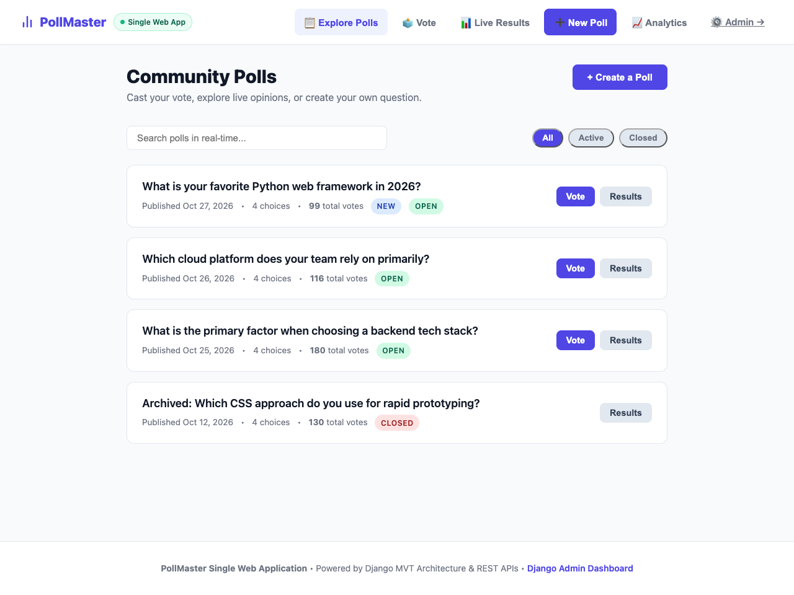
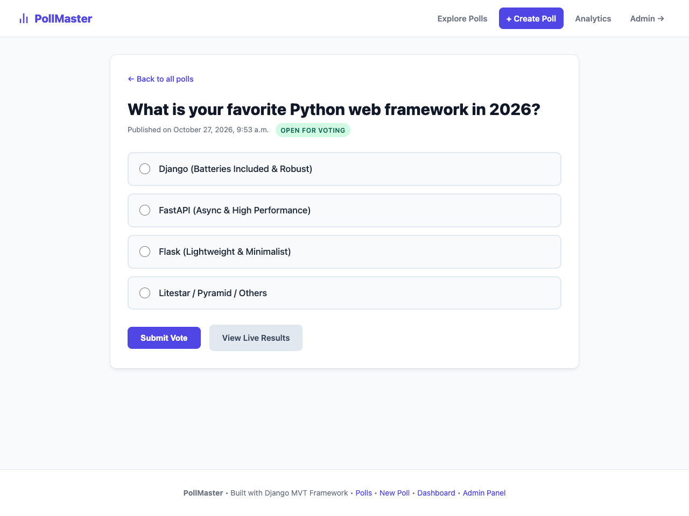
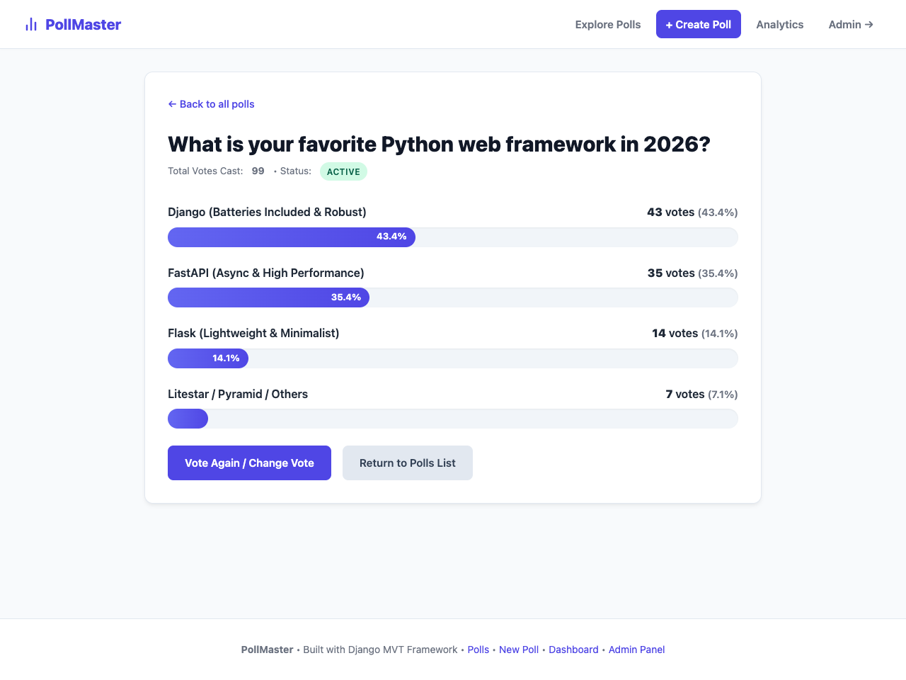
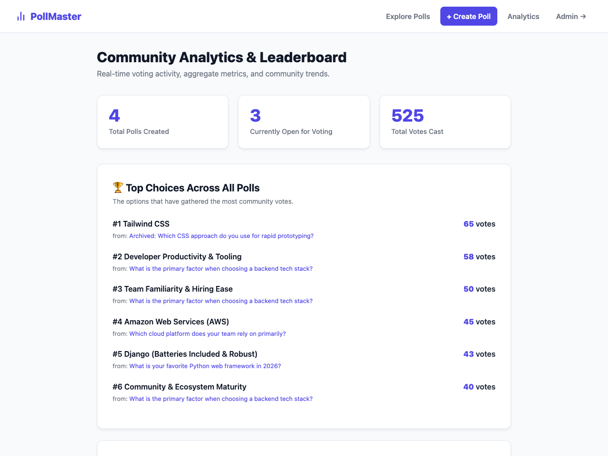

# 🗳️ PollMaster: Full-Stack Django Polling Web Application

[](https://computers-mattress-documented-enhancements.trycloudflare.com/)
[](https://render.com/deploy?repo=https://github.com/yashuraghuvanshi4-pixel/django-polls-app)
[](https://www.python.org/)
[](https://djangoproject.com/)

A production-grade, cleanly structured Polling and Voting application designed according to Django's official workflow, the **Model-View-Template (MVT)** architecture, Django Forms validation, atomic database updates (`F()` expressions), and the Django Admin framework.

---

## 🚀 Live Links
- **Active Live Link**: [Open PollMaster](https://computers-mattress-documented-enhancements.trycloudflare.com/)
- **1-Click 24/7 Cloud Deploy**: [Deploy to Render](https://render.com/deploy?repo=https://github.com/yashuraghuvanshi4-pixel/django-polls-app)
- **Admin Portal**: [Admin Login](https://computers-mattress-documented-enhancements.trycloudflare.com/admin/) *(Username: `admin` / Password: `adminpassword123`)*

---

## 📸 Screenshots

### 1. Explore Polls & Search


### 2. Interactive Voting Form


### 3. Real-Time Results Breakdown


### 4. Community Analytics & Leaderboard


---

## ⚡ Quickstart (Local)

```bash
# Clone the repository
git clone https://github.com/yashuraghuvanshi4-pixel/django-polls-app.git
cd django-polls-app

# Create and activate virtual environment
python3 -m venv .venv
source .venv/bin/activate

# Install dependencies
pip install -r requirements.txt

# Run migrations & seed demo data
python manage.py migrate
python seed_demo_data.py

# Run tests
python manage.py test

# Start local development server
python manage.py runserver 0.0.0.0:8001
```

Visit `http://127.0.0.1:8001/` in your browser.
